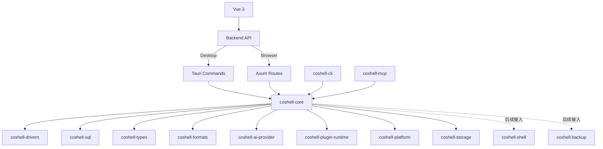

# CoShell 架构说明

> 状态：初始化基线
> 设计参考：[DBX 技术结构文档](dbx-technical-architecture.md)

## 1. 架构目标

CoShell 采用 DBX 已验证的分层原则，但不复制 DBX 的数据库产品功能。初始化阶段只建立以下稳定契约：

- Vue 工作台只有一个业务 API 入口；
- Tauri 与 Web 只是两种传输适配；
- `coshell-core` 拥有应用业务编排；
- SQL、驱动、格式、AI、插件和平台能力各自独立；
- CLI、MCP、Web 和桌面端是平级消费者；
- 自动化守卫阻止底层 crate 反向依赖应用层。

## 2. 模块关系



## 3. Rust 所有权

| Crate | 所有权 | 不应包含 |
| --- | --- | --- |
| `coshell-types` | DTO、序列化契约、跨层值对象 | I/O、业务状态、驱动实现 |
| `coshell-platform` | 路径、进程、版本和宿主能力 | 领域规则 |
| `coshell-storage` | 本地数据库、迁移和事务快照 | 网络和应用编排 |
| `coshell-shell` | 命令分析、风险规则和脱敏 | 命令执行和 UI |
| `coshell-backup` | 备份格式、加密和 WebDAV 传输 | 业务冲突决策 |
| `coshell-formats` | 纯格式转换和编码 | 数据源访问 |
| `coshell-sql` | SQL 解析、分类和生成 | 查询执行、凭据 |
| `coshell-ai-provider` | 模型 Provider 和流协议 | 工具业务编排 |
| `coshell-plugin-runtime` | 插件 Manifest、权限和生命周期 | 具体业务插件实现 |
| `coshell-drivers` | 数据源连接与执行适配 | 应用工作流和 UI 状态 |
| `coshell-core` | 跨能力的应用编排、安全和状态 | 传输协议细节 |
| `coshell-web` | HTTP 路由和 Web 运行时 | 重复业务实现 |
| `coshell-cli` | 命令行参数与输出 | 重复业务实现 |
| `coshell-mcp` | MCP 协议与工具暴露 | 重复业务实现 |
| `src-tauri` | 桌面宿主和 Command | 重复业务实现 |

实现层 crate 不得依赖 `coshell-core`、Web、CLI、MCP 或桌面应用。`coshell-core` 不得依赖任何入口应用。

## 4. 最小纵向链路

初始化链路用于验证边界是否真正连通：

```text
App.vue
  -> lib/backend/api.ts
  -> tauri.ts 或 http.ts
  -> Tauri command 或 Axum route
  -> coshell-core health/about service
  -> coshell-types response DTO
```

后续功能沿同一路径扩展。只有窗口、托盘等明确属于桌面宿主的功能允许没有 Web 对应实现；Web 端仍需给出清晰的能力不可用结果。

## 5. 前端边界

- `main.ts` 只负责应用启动和全局依赖安装；
- `StartupGate.vue` 承载启动检查，不提前创建领域状态；
- `App.vue` 负责编排工作台，不直接写传输代码；
- `lib/backend/api.ts` 是组件和 store 唯一允许依赖的后端入口；
- `lib/backend/tauri.ts` 与 `http.ts` 必须保持签名一致；
- 可复用状态进入 Pinia，可复用行为进入 composable 或 `lib`。

## 6. 扩展边界

### Agent

Agent 是独立进程，通过版本化 JSON-RPC 2.0 消息通信。主进程负责启动、握手、超时、取消和回收；Agent 负责具体外部系统驱动。协议 DTO 应进入共享契约，不通过日志或未结构化文本承载业务结果。

### 插件

插件通过 Manifest 声明身份、版本、能力和权限。插件运行时负责校验与生命周期，插件业务代码不进入核心 crate。正式安装链路必须在实现时加入内容哈希、签名、权限批准和路径安全检查。

### Packages

`packages/` 只用于 npm 启动器、平台二进制包或前端共享包。原生业务实现留在 Rust crate，避免 Node 启动器发展成第二套后端。

## 7. 错误与运行契约

- 跨进程/跨协议错误使用稳定 `code`、用户消息和可选诊断详情；
- 不把内部堆栈、凭据或环境密钥返回给前端；
- 长任务需要 operation ID、取消、进度和幂等语义；
- transport 负责协议错误映射，core 负责领域错误；
- health 响应只报告非敏感的版本、运行形态和状态。

## 8. 架构守卫

`scripts/architecture.test.mjs` 校验：

- 所有预期 crate 和入口存在；
- Rust package 名称唯一；
- 实现层不反向依赖 core 或入口 crate；
- core 不依赖 Web、CLI、MCP 或桌面入口；
- 前端三层入口与双 transport 文件存在；
- Agent、插件和 packages 的边界文档存在。

守卫检查稳定架构事实，不检查局部函数名或源码排版。

## 9. 演进规则

1. 新领域先定义 DTO 和所有权，再写入口适配。
2. 同一行为只在 core 或所属下层 crate 实现一次。
3. 入口协议使用行为测试验证，不用源码字符串快照代替。
4. 新增 crate 时更新 workspace、本文档和架构守卫。
5. 涉及写入、凭据、插件、AI 工具或远程执行时，先补安全模型和失败语义。
