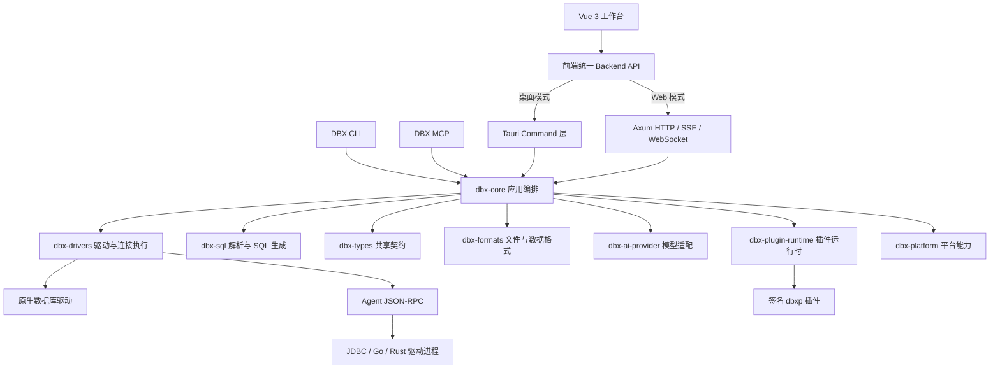

# DBX 技术结构文档

> 文档基线：DBX `main` 分支，提交 `815d4cced`（2026-11-10）
> 仓库位置：`D:\workspace\myutils\dbx`
> 项目版本：`0.6.68`

## 1. 项目定位

DBX 是一个面向多种数据库、数据服务和消息中间件的管理工具。产品以同一套 Rust 核心能力支撑多种运行形态：

- Tauri 桌面应用；
- Web/Docker 服务；
- 原生 CLI；
- MCP Server；
- JDBC、Go 或 Rust Agent 驱动；
- 可安装的 `.dbxp` 插件。

前端使用 Vue 3，桌面壳使用 Tauri 2，Web 服务使用 Axum。核心数据库能力、SQL 处理、驱动、类型、安全策略和持久化主要由 Rust workspace 承载。长尾数据库通过独立 Agent 进程接入，可选能力通过插件系统扩展。

## 2. 总体架构



核心设计原则是“入口层薄、业务编排集中、底层能力单向依赖”：桌面、Web、CLI 和 MCP 只负责协议适配与运行时装配，跨数据库业务流程由 `dbx-core` 统一组织。

## 3. 仓库结构

| 路径 | 职责 |
| --- | --- |
| `apps/desktop/src/` | Vue 3 前端、Pinia 状态、工作台组件、编辑器、数据网格、AI 与插件界面 |
| `src-tauri/` | Tauri 桌面壳、Command 适配、窗口、托盘、深链、启动恢复和迁移门禁 |
| `crates/dbx-core/` | 应用业务编排：连接、查询、Schema、数据工作流、AI、安全和持久化 |
| `crates/dbx-drivers/` | 驱动统一入口、连接执行、Agent 生命周期和数据库能力 |
| `crates/dbx-driver-*` | MySQL、PostgreSQL、MongoDB、Redis、SQL Server 等拆分驱动实现 |
| `crates/dbx-sql*` | SQL 解析、方言、风险分类、DDL/DML、Schema diff 和数据网格 SQL |
| `crates/dbx-types/` | 跨层 DTO、数据库身份、连接配置、查询与元数据类型 |
| `crates/dbx-formats/` | CSV、XLSX、文本、ZIP、日期时间等格式处理 |
| `crates/dbx-ai-provider/` | 模型 Provider、AI CLI 适配、流事件和 Token 用量 |
| `crates/dbx-plugin-runtime/` | 插件清单、签名、安装、Marketplace、进程和 Host API |
| `crates/dbx-platform/` | 进程、路径、代理、下载、版本和平台提示等通用能力 |
| `crates/dbx-web/` | Web/Docker 的 Axum 服务端与 HTTP 路由 |
| `crates/dbx-cli/` | 原生 `dbx` CLI |
| `crates/dbx-mcp/` | MCP stdio 和 Streamable HTTP 服务 |
| `crates/dbx-sqlite-worker/` | 隔离的 SQLite 文件执行 Worker 与协议 |
| `agents/` | Java/JDBC、Go、Rust 独立 Agent 驱动工程 |
| `plugins/` | 插件 SDK、CLI、Schema、连接类型、方言和示例 |
| `packages/` | CLI、MCP、Plugin CLI 的 npm 包装及各平台二进制包 |
| `docs/` | 官方文档站 |
| `deploy/` | Docker、1Panel、演示环境和数据库测试环境资源 |
| `scripts/` | 开发、发布、生成、架构校验和 benchmark 脚本 |
| `vendor/` | 为兼容性或定制行为维护的上游 Rust crate |

## 4. Rust 分层和依赖方向

Rust workspace 的权威边界定义在 `crates/ARCHITECTURE.md`，并由 `scripts/core-architecture.test.mjs` 在 CI 中检查。

```text
desktop / web / cli / mcp
            |
         dbx-core
            +-- dbx-drivers -- dbx-sql -- dbx-types
            |       +-- dbx-platform
            |       +-- dbx-sqlite-worker
            +-- dbx-plugin-runtime -- dbx-types + dbx-platform
            +-- dbx-ai-provider -- dbx-platform
            +-- dbx-formats
            +-- dbx-sql / dbx-types
            +-- dbx-platform
```

### 4.1 `dbx-core`

`dbx-core` 是应用编排层，其主要业务目录如下：

| 目录 | 业务职责 |
| --- | --- |
| `connection/` | 连接路由、凭据、运行配置、JDBC 配置和任务监督 |
| `query/` | 查询编排、取消、事务、文档/Redis/HBase 操作和对象缓存 |
| `schema/` | 元数据编排和运行时 Schema 操作 |
| `data/` | 导入导出、迁移、比较、备份、文档和脚本工作流 |
| `ai/` | 数据库 Agent 循环、工具调用、审批、解释和 MCP 策略 |
| `admin/` | Nacos、Consul、MQ、MQTT 管理能力 |
| `persistence/` | 本地存储、历史、保存 SQL、配置和云同步 |
| `safety/` | 生产安全、写入解锁和风险指标 |
| `host/` | 更新、变更日志和外部应用集成 |
| `db/` | 驱动兼容导出及特定数据库业务覆盖 |

`dbx-core/src/lib.rs` 还保留部分旧公共路径的重导出，以维持桌面、Web、CLI 和 MCP 的兼容性。新增实现应放入实际所有者 crate，不应利用重导出把底层实现重新堆回 core。

### 4.2 下层 crate 的所有权

- `dbx-types` 只拥有共享契约，不引入连接池或驱动 SDK。
- `dbx-sql` 拥有解析、方言、风险和 SQL 生成，不执行数据库业务。
- `dbx-drivers` 拥有数据库连接、隧道、执行、取消和 Agent 分发，不编排应用工作流。
- `dbx-formats` 处理格式和编码，不依赖数据库请求。
- `dbx-ai-provider` 处理模型通信，不执行数据库工具业务。
- `dbx-plugin-runtime` 管理插件生命周期，不实现具体数据库驱动。
- `dbx-platform` 提供宿主通用能力，不承载数据库身份和业务规则。

下层 crate 不得反向依赖 `dbx-core`，包括 build dependency 和 dev dependency。

## 5. 前端结构

### 5.1 启动流程

前端入口是 `apps/desktop/src/main.ts`。启动顺序为：

1. 安装调试日志和全局错误处理；
2. 检查旧 WebView/浏览器兼容性；
3. 恢复持久化外观设置；
4. 判断是否为插件浮动窗口；
5. 主窗口加载 i18n 和 `StartupGate.vue`；
6. Web 模式执行认证检查；
7. 初始化密码查看能力和安全迁移；
8. 通过门禁后异步加载 `App.vue` 工作台。

`StartupGate.vue` 将登录、语言加载、密钥/存储迁移与业务 Store 初始化隔离开，避免未认证或迁移未完成时提前创建业务状态。

### 5.2 统一后端接口

`apps/desktop/src/lib/backend/api.ts` 是前端访问后端的统一入口：

```ts
isTauriRuntime()
  ? import("@/lib/backend/tauri")
  : import("@/lib/backend/http")
```

- `tauri.ts` 将函数映射到 Tauri `invoke`、Channel 和桌面事件；
- `http.ts` 将同一函数面映射到 HTTP、SSE 或 WebSocket；
- `api.ts` 延迟选择实现，并统一记录操作耗时和错误。

因此，新增后端能力时通常需要同步完成：

1. 前端 API 类型和统一导出；
2. Tauri transport 实现；
3. HTTP transport 实现；
4. Tauri command；
5. Web route；
6. `dbx-core` 共享业务实现。

仅桌面可用的窗口、托盘或本地系统能力可以明确例外，但应在 Web 端提供可解释的降级行为。

### 5.3 前端业务组织

- `components/`：领域组件和工作台界面；
- `stores/`：Pinia 业务状态；
- `composables/`：跨组件流程和生命周期逻辑；
- `lib/`：无界面业务函数、协议适配、格式化和领域规则；
- `types/`：前端 DTO 与生成类型；
- `i18n/`：多语言资源和后端错误翻译；
- `docs/`：数据库文档导出/查看相关前端模块。

`App.vue` 是大型工作台编排组件。新增独立逻辑时应优先放进领域 composable、store 或 `lib` 模块，避免继续扩大根组件。

## 6. 桌面端结构

桌面二进制入口为 `src-tauri/src/main.rs`：后台备份 Worker 命中时进入 Worker，否则调用 `dbx_lib::run()`。

`src-tauri/src/lib.rs` 负责：

- 选择数据目录和便携模式；
- 初始化 Storage、密钥策略和迁移门禁；
- 注册方言、插件和热加载；
- 构造共享 `AppState`；
- 注册 Tauri Command；
- 初始化窗口、托盘、深链和单实例行为；
- 管理更新、后台备份、Redis Pub/Sub、MCP HTTP bridge；
- 处理平台差异和旧 Windows/WebView2 兼容性。

`src-tauri/src/commands/` 是协议适配层。Command 应完成参数接收、状态取得、错误转换和事件桥接，复杂业务应委托 `dbx-core`。

## 7. Web/Docker 结构

`crates/dbx-web` 使用 Axum 提供 Web 后端，主要组成包括：

- `main.rs`：配置、存储、共享状态、服务监听和静态 SPA；
- `state.rs`：`WebState` 及测试状态构造；
- `auth.rs`、`credentials.rs`：认证和凭据边界；
- `routes/`：按连接、查询、Schema、导入导出、AI、插件等领域拆分的 HTTP 路由；
- `sse.rs`：服务端事件；
- Redis Pub/Sub 等实时能力的 WebSocket 路由；
- `web_mcp.rs`：Web 形态的 MCP 集成。

Web 路由与 Tauri Command 应委托同一 core 业务函数，以保证桌面和 Web 行为一致。认证、密码可见性和服务器托管任务是 Web 形态特有的边界。

## 8. 数据库执行体系

### 8.1 原生驱动

主流数据库由 Rust 原生 crate 实现，例如 MySQL、PostgreSQL、MongoDB、Redis、SQL Server 和 Elasticsearch。`dbx-drivers` 统一暴露连接、查询、元数据、能力判断、隧道和取消语义。

### 8.2 Agent 驱动

长尾或厂商数据库使用独立 Agent 进程：

```text
DBX 主进程
   | stdin/stdout JSON-RPC 2.0
   v
Agent 可执行文件或 Java JAR
   |
   v
原生驱动或 JDBC 驱动
```

Agent 工程位于 `agents/`：

- Java Agent 使用 Gradle/JDK 21，公共运行时位于 `agents/common`；
- Go/Rust Agent 优先用于存在成熟原生驱动的数据库；
- 多会话 JDBC Agent 使用 HikariCP；
- Agent 与主进程共享版本化 JSON-RPC 协议；
- 修改既有 Agent 时版本通常由发布流程自动递增。

新增数据库支持前，应先判断适合原生 Rust driver、原生 Agent、JDBC Agent 还是插件连接提供者。

## 9. SQL 与数据库元数据

SQL 能力拆分到多个 crate：

- `dbx-sql-core`：基础 SQL 工具和共享语义；
- `dbx-sql-dialect`：方言注册、加载和数据库特定描述；
- `dbx-sql-data`：数据查询与网格相关 SQL；
- `dbx-sql-schema`：Schema 和 DDL 相关能力；
- `dbx-sql`：对上组合解析、生成、风险分类和 Schema diff。

构建时资源来自：

- `plugins/connection-types/`：连接类型注册表；
- `plugins/dialects/`：方言、数据类型、DDL 和元数据规则；
- `plugins/mappings/`：跨方言类型映射。

修改这些资源后需要运行生成脚本，并执行架构检查，避免 Rust、TypeScript 和运行时资源出现漂移。

## 10. 插件体系

DBX 插件是版本化 `.dbxp` ZIP 包，可包含：

- 原生 sidecar；
- 沙箱化工作台 UI；
- 连接类型 Provider；
- 文件系统 Provider；
- 图标和静态资源。

插件平台契约为 manifest v1、Host API 1.x、sidecar protocol v1。安装流程会检查目标平台、大小、SHA-256、Manifest 身份、权限、发布者和 Ed25519 仓库签名。

关键目录：

- `plugins/sdk/rust/dbx-plugin-sdk`；
- `plugins/sdk/go/dbx-plugin-sdk`；
- `plugins/sdk/cli`；
- `plugins/sdk/packager`；
- `plugins/examples/hello-workbench`；
- `plugins/manifest.schema.json`；
- `plugins/marketplace.schema.json`。

插件源码、Marketplace 目录和用户安装后的插件是三类不同资产。官方 Marketplace 元数据位于独立 `dbx-store` 仓库。

## 11. CLI 与 MCP

### 11.1 CLI

`crates/dbx-cli` 构建原生 `dbx` 命令，npm 包 `@dbx-app/cli` 只负责启动匹配平台的二进制。

CLI 可以读取 DBX 连接存储并执行受限查询；设置 `DBX_WEB_URL` 后切换到 Web 后端。写操作和危险 SQL 使用显式安全开关，默认只读。

### 11.2 MCP

`crates/dbx-mcp` 提供 MCP 服务实现，支持 stdio 和 Streamable HTTP。npm 包 `@dbx-app/mcp-server` 同样是原生二进制启动器。

MCP 复用 DBX 的连接、Schema、SQL、Redis、MongoDB、Agent 和安全策略，并增加：

- 连接、分组和数据库范围控制；
- 工具 allowlist；
- 每次请求重新加载的执行策略；
- SQL、Redis、MongoDB 写入安全门禁；
- 与桌面工作台联动的打开表格/展示结果能力。

## 12. 数据、安全与生命周期

### 12.1 共享状态

桌面和 Web 都围绕 `AppState` 组织运行资源，典型状态包括：

- 数据库连接池和 Agent 会话；
- SSH/代理隧道；
- 运行中查询、取消句柄和事务；
- 临时凭据和写入解锁状态；
- 插件/驱动运行时；
- 事件广播与缓存。

连接修改、断开或应用退出相关变更必须检查资源释放、取消、重连和并发竞态。

### 12.2 安全边界

高风险区域包括：

- 密钥和配置加密；
- 操作系统 Keychain/Secret Store；
- 生产连接识别和写入解锁；
- SQL 风险分类；
- AI 工具审批；
- MCP 访问策略；
- Web 登录和密码查看能力；
- 插件权限、签名和仓库信任；
- 安全迁移门禁。

此类改动不能只验证 UI，应覆盖 core 行为、协议适配和失败路径。

## 13. 构建与开发环境

基础要求：

- Node.js `>=22.13.0`，仓库 `.nvmrc` 当前为 `22.23.3`；
- pnpm `10.34.7`；
- Rust `>=1.88`；
- Make；
- Agent 开发额外需要 JDK 21。

常用命令：

```bash
make                 # 安装依赖并启动 Tauri 开发环境
make dev-fast        # 跳过部分重型能力的桌面开发
make dev-web         # 只启动前端
make dev-backend     # 只启动 Web 后端
make docs            # 启动文档站

pnpm typecheck       # Vue/TypeScript 类型检查
pnpm lint            # 前端 lint
pnpm test            # Vitest
pnpm test:packages   # CLI/MCP/Plugin CLI package 测试
pnpm test:architecture

make cargo-check-fast
make cargo-test-fast
```

`make cargo-test-fast` 使用 `cargo nextest` 执行单元/集成测试，并单独执行 doctest。仓库固定建议的 nextest 版本为 `0.9.137`。

## 14. 测试结构

| 范围 | 测试位置/方式 |
| --- | --- |
| Vue、composable、store、lib | 与源码相邻的 `__tests__`、`*.spec.ts`、`*.test.ts` |
| 前端组件行为 | Vitest + happy-dom，必要时挂载真实 Vue 组件 |
| Rust 单元测试 | 各 crate 模块内 `#[cfg(test)]` |
| Rust 集成测试 | 各 crate 的 `tests/`，跨层测试主要放 `dbx-core/tests/` |
| 架构边界 | `scripts/core-architecture.test.mjs` |
| npm packages | 各 `packages/*` 测试和安装验证脚本 |
| Java Agent | `cd agents && ./gradlew test` |
| Go/Rust Agent | 各独立 Agent 工程自己的测试命令 |
| 真实数据库 | `#[ignore]` live 测试和声明的 `DBX_LIVE_*` 环境 |

测试应按风险选择范围。普通单元测试通过不代表所有数据库版本矩阵已验证；live 测试未运行时必须明确说明。

## 15. Feature 与兼容性约束

### 15.1 SQLite Feature

以下 SQLite 后端选择互斥：

- `sqlite-bundled`；
- `sqlite-sqlcipher`；
- `sqlite-multiple-ciphers`。

不能使用 workspace `--all-features` 代替合法组合验证。

### 15.2 Vendored crate

`vendor/` 中的定制依赖承担真实兼容性职责，例如：

- Windows 7 / Server 2012 R2 的 WebView2 和系统 API 兼容；
- WebView2 渲染进程恢复和剪贴板历史；
- 旧 MQTT 协议；
- SQL Server 非法 UTF-16/字符集容错；
- Tauri 更新和安装流程定制。

升级相关上游依赖前，必须确认这些补丁是否已被上游覆盖，不能直接删除 patch。

## 16. 功能变更落点指南

| 需求类型 | 首选改动位置 |
| --- | --- |
| 新增纯前端交互 | `components/` + `composables/` + `stores/`/`lib/` |
| 新增桌面与 Web 共用业务 | `dbx-core`，入口层仅做适配 |
| 新增 SQL 生成或风险规则 | `dbx-sql*` |
| 新增数据库原生执行能力 | 对应 `dbx-driver-*`，由 `dbx-drivers` 汇总 |
| 新增长尾数据库 | 优先评估原生 Agent，再评估 JDBC Agent |
| 新增可选第三方能力 | `.dbxp` 插件和 Host API |
| 新增共享 DTO | `dbx-types`，同步前端传输类型 |
| 新增导出格式 | `dbx-formats`，业务编排保留在 core |
| 新增 AI Provider | `dbx-ai-provider`；数据库工具执行放 core |
| 新增 HTTP/Tauri 功能 | 同时维护统一 API、两种 transport、Command、Route 和 core |
| 修改连接类型/方言 | `plugins/connection-types` / `plugins/dialects`，随后重新生成 |

## 17. 主要复杂点和维护风险

1. **双入口契约**：桌面 Command 与 Web Route 容易出现只修一端的问题。
2. **共享状态生命周期**：连接、查询、事务、隧道、Agent 和临时凭据存在并发与清理要求。
3. **大型热点模块**：根工作台、前端 transport、连接和 MCP 服务文件较大，修改前应从具体功能入口反向追踪。
4. **生成链**：连接类型、方言和协议资源同时影响 Rust、TypeScript、构建输入和发布产物。
5. **数据库语义差异**：事务 DDL、标识符、分页、类型映射和元数据行为不能仅按数据库名称散落判断。
6. **安全边界广**：生产写入、凭据、AI/MCP、插件和 Web 认证需要跨层验证。
7. **平台兼容性**：Windows 旧版本、WebView2、macOS 签名、Linux WebKit/GTK 都有专门路径。
8. **外部运行时**：Agent、JRE、数据库服务和 live 测试环境可能影响可复现性。

## 18. 推荐的改动检查流程

1. 从用户行为找到前端组件或 CLI/MCP 工具入口；
2. 沿统一 API 追踪 Tauri/HTTP 两条 transport；
3. 确认业务是否已经下沉到 `dbx-core`；
4. 判断底层实现应归属 drivers、sql、types、formats、AI、plugin 或 platform；
5. 检查连接、取消、超时、重试、错误和资源清理；
6. 检查桌面/Web/CLI/MCP 是否共享该契约；
7. 增加最小但覆盖风险的行为测试；
8. 运行目标模块测试、类型检查和架构守卫；
9. 对数据库专项行为注明是否完成真实数据库验证。

## 19. 参考入口

- [DBX 项目说明](../../dbx/README.zh-CN.md)
- [贡献指南](../../dbx/CONTRIBUTING.zh-CN.md)
- [Rust 架构边界](../../dbx/crates/ARCHITECTURE.md)
- [前端入口](../../dbx/apps/desktop/src/main.ts)
- [前端统一 API](../../dbx/apps/desktop/src/lib/backend/api.ts)
- [Tauri 运行入口](../../dbx/src-tauri/src/lib.rs)
- [Core 导出](../../dbx/crates/dbx-core/src/lib.rs)
- [Web 后端](../../dbx/crates/dbx-web/src/main.rs)
- [Agent 说明](../../dbx/agents/README.zh-CN.md)
- [插件平台](../../dbx/plugins/README.md)
- [MCP Server](../../dbx/packages/mcp-server/README.md)

## 20. 基线说明

仓库根目录的 `handoff.md` 是 2026 年 7 月导出的历史任务交接记录，其中部分模块路径和任务状态已经过时。它可以作为历史上下文参考，但不应作为当前架构或待办事项的权威来源。当前结构应以源码、`crates/ARCHITECTURE.md`、`CONTRIBUTING.zh-CN.md` 和 CI 架构守卫为准。
