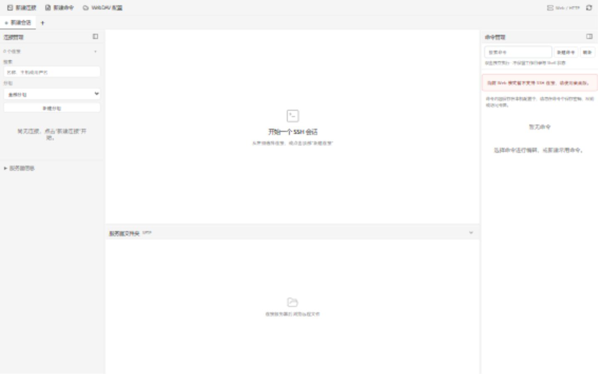

# 工作台布局校正验证记录

日期：2026-11-17。范围：用户标注截图对应的工作台布局与 OpenSpec 第 12 节，不修改 SSH/SFTP/WebDAV 后端协议。

## 实现与评审

- 顶部从最左侧提供新建连接、新建命令、WebDAV 配置；移除品牌块、重复标签和页面大标题。
- 连接列表不再放在中央网格内部，命令管理不再嵌套在文件区；左右侧栏与中央上下分区通过专用布局组件组合，未连接也保留面板。
- 顶部新建命令操作打开当前会话的右侧编辑器，不维护第二份独立页面实例；名称输入获得焦点，重复新建不会清空已有草稿，并提供取消编辑。
- 收起仅隐藏并禁用焦点访问，保留文件/命令组件及其内存状态；侧栏宽度、上下比例和收起偏好在本地保存，不写入业务连接或远端备份。
- 隐藏会话接收非活动状态并拒绝按键/粘贴。模态确认在侧栏之上，侧栏覆盖模式不遮挡确认框。
- 独立代码评审发现并修复模态层级、短窗口拖拽比例失效、新建命令焦点三项问题。

## 自动化验证

- 先补布局父级/未连接面板、顶部直接操作、配置往返、草稿保留和隐藏终端输入回归，观察失败后实现修正。
- 组件回归还覆盖文件面板实例保留、分隔条指针/键盘调整、上下限、本地偏好恢复和窄窗口覆盖面板。
- `pnpm check` 覆盖架构守卫、类型检查、前端测试与生产构建；OpenSpec 使用 `openspec validate --all --strict`。
- Rust 业务代码未修改，本批使用前端组件和真实 Rust DTO 序列化契约测试验证现有接口。

## 真实浏览器验证

使用本机开发页面进行渲染核查，不创建真实 SSH 会话、不保存连接或备份配置，不执行远程命令。

| 场景 | 观察结果 |
| --- | --- |
| 1200 × 760 | 左栏 250px，右栏 280px，中央终端/文件区独立，无页面横向溢出 |
| 1440 × 900 | 三列铺满可用窗口，右栏贯穿高度，顶部操作靠左 |
| 900 × 600 | 命令栏默认收起；显式展开为覆盖侧栏，不挤压中央区域 |
| 700 × 600 | 两侧栏收起后中央宽 632px，无横向溢出 |
| 真实指针拖拽 | 终端比例从 64 调整为约 50.76，文件区上边界随之移动 |
| 1200 × 500 键盘分隔条 | 比例从约 53.76 调整为约 56.76，终端高度从 227.39px 变为 240.08px |
| 新建命令与折叠往返 | 未保存名称草稿保留，未保存到后端，最后取消编辑 |
| 覆盖侧栏上的新建连接 | 模态层级 200 高于侧栏 30，焦点位于连接编辑框，最后取消 |

验证截图为 Web 入口的未连接状态；Web 入口原有 SSH 不支持提示不代表桌面 SSH 回归失败。已恢复临时视口并关闭验收页。未运行真实 macOS 安装、系统屏幕阅读器或真实远程服务器交互验收。

## 最终检查与安装包

- `pnpm check` 通过：9 项架构守卫、类型检查、20 个测试文件中的 106 项测试及生产构建均通过。Vite 对单个约 503 kB 的脚本给出体积提示，构建成功。
- `openspec validate --all --strict` 通过；第 12 节任务全部勾选，整个 change 为 38/70，既有未完成任务保持原状态。
- Windows x64 NSIS release 构建通过；安装包为 `target/x86_64-pc-windows-gnu/release/bundle/nsis/CoShell_0.1.0_x64-setup.exe`，大小 4272224 字节，未签名，使用系统已有 WebView2。
- 安装包 SHA-256：`2265361ce46e25c94d61c897c7bf84600d6f2bde22dd98baef13362e1db27aa4`。
